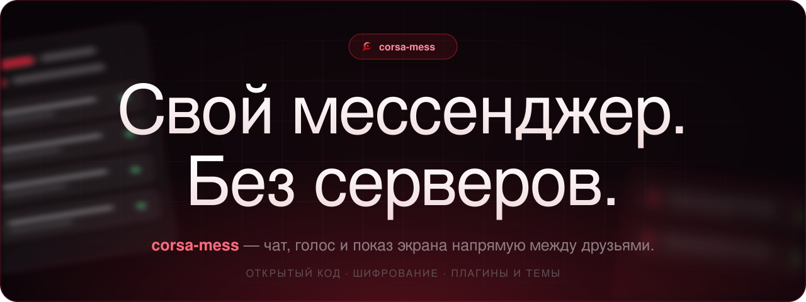

<p align="center"></p>

<p align="center">
  <a href="https://github.com/kolyagames/corsa_mess/releases/latest"><b>Скачать для Windows</b></a> ·
  <a href="#android"><b>Android</b></a> ·
  <a href="#быстрый-старт">Быстрый старт</a> ·
  <a href="https://kolyagames.github.io/corsa_mess/">Сайт</a> ·
  <a href="app/README.md">Безопасность</a>
</p>

Открытый мессенджер для друзей без центральных серверов. Чат, голосовые каналы, показ экрана, плагины и темы.
Один из вас нажимает «Запустить сервер», остальные подключаются по коду или по адресу.

## Скачать (Windows)

1. Откройте раздел [Releases](https://github.com/kolyagames/corsa_mess/releases/latest) и скачайте `corsa-mess-win32-x64.zip`.
2. Распакуйте архив в любую папку и запустите `corsa-mess.exe`.
3. Windows может показать предупреждение SmartScreen: сборка не подписана. Нажмите «Подробнее» → «Выполнить в любом случае».

Установка не нужна. Данные (профиль, стикеры, комнаты) хранятся в `%APPDATA%\corsa-mess`.

## Быстрый старт

**Если вас пригласили:**
1. Запустите `corsa-mess.exe`.
2. Попросите у друга код комнаты, он выглядит как `abcdef-ghijk`.
3. На главной странице вставьте код в поле «Код или адрес» и нажмите «Подключиться». Если комната закрыта, введите пароль, который назвал друг.
4. Откройте Настройки → «Мой профиль» (или нажмите на своё имя внизу слева), задайте имя и аватар. Аватар — это ссылка на картинку с Imgur или другого разрешённого сайта.

**Если хотите создать комнату сами:**
1. На главной странице в блоке «Запустить свой сервер» введите название и пароль, нажмите «Запустить сервер».
2. Скопируйте код и отправьте друзьям. Для друзей из другой сети нажмите «Открыть доступ из интернета».

## Android

Android-версия — тот же интерфейс (те же дизайны, иконки, настройки), что и на Windows: она открывает
веб-часть приложения (`app/src`) в системном WebView через [Capacitor](https://capacitorjs.com), а не
переделывает его заново. Код обёртки — в [`app-android/`](app-android).

**Сейчас (версия 1) с телефона можно:** присоединиться к комнате, которую кто-то уже запустил на компьютере
(по коду или адресу), писать и читать сообщения, реакции, ответы, правки, закреплённые, личные сообщения,
файлы и картинки, видеть участников, получать уведомления, менять дизайн и профиль.

**Пока недоступно с телефона** (техническая причина — ниже, это не забыли, а сознательно не входит в первую
версию): запуск своей комнаты, голос, камера, показ экрана, интернет-мост, глобальные горячие клавиши,
«играет в…» через Discord/Spotify, автообновление в одно нажатие. Запустите комнату на компьютере — с
телефона к ней можно будет присоединиться уже сейчас.

Почему не всё сразу: самоподписанный сертификат сервера комнаты (см. [безопасность](app/README.md)) обычный
WebView не умеет закреплять сам — для этого на Android написан отдельный нативный слой поверх OkHttp
(`app-android/android-src`, `app-android/android/.../CorsaNativePlugin.kt`), копирующий ту же модель
доверия, что в Windows-сборке. Хостинг своей комнаты, показ экрана и системные интеграции требуют
постоянно работающего процесса и API, которых на телефоне нет в том же виде, что на столе, — это пойдёт
следующими шагами.

Собранный apk появляется в [Releases](https://github.com/kolyagames/corsa_mess/releases/latest) и
в [Actions](https://github.com/kolyagames/corsa_mess/actions/workflows/android.yml) после каждого пуша
в `main` — собирает [GitHub Actions](.github/workflows/android.yml), локально Android SDK не нужен.
Сборка пока без подписи релизным ключом (как и Windows-версия): Android тоже покажет предупреждение
при установке, нужно подтвердить «Всё равно установить».

Собрать и запустить локально (нужен Android Studio / Android SDK):

```bash
cd app-android
npm install
npm run sync        # собирает www из app/src и готовит android/
npx cap open android   # откроет проект в Android Studio
```

## Как подключиться

- В одной сети: комната хозяина сама появится на главной в блоке «В вашей сети», нажмите «Войти». Можно и по коду вида `abcdef-ghijk`.
- Через интернет-мост (без роутера и VPN): хозяин в карточке своей комнаты нажимает «Открыть через мост» (нужен пароль комнаты) и присылает код вида `bore.pub:12345`. Комната открывается через общий публичный relay [bore](https://github.com/ekzhang/bore): шифрование и пароль остаются сквозными, relay не видит переписку и голос, но знает адреса подключающихся. Если relay недоступен, мост не работает.
- Через Radmin VPN, ZeroTier или Hamachi: комнаты из общей сети тоже видны в «В вашей сети».
- Через интернет: хозяин нажимает «Открыть доступ из интернета» (нужны пароль сети и роутер с UPnP) и присылает код, который появится ниже.
  Если не получается, используйте Radmin VPN, ZeroTier или Tailscale и подключайтесь по адресу из этой сети.

## Возможности

- Четыре дизайна: «Неон», «Глина», «Экспрессив», «Стекло», у каждого светлый и тёмный режим и свой «почерк» иконок: угловые линии со свечением, мягкая двухцветная заливка, плотные сплошные фигуры, тонкий контур. Все 81 иконка нарисованы с нуля, эмодзи в интерфейсе не используются.
- Цвета из аватарки: приложение достаёт из неё два главных цвета и красит по ним акцент, кнопки, фон, рамки и баннеры градиентами. Карточки профилей без своего цвета и баннера красятся по аватаркам их владельцев. Всё выключается в Настройки → Внешний вид.
- Голос через интернет: если комната не в локальной сети, соединение идёт напрямую через NAT с помощью STUN (можно отключить или указать свой), для сложных сетей есть поле своего TURN-сервера.
- Внешний вид настраивается целиком: цвет, шрифт, размер текста, скругление, плотность, сообщения списком, пузырями или в строку, форма аватаров, фон по ссылке, свой CSS.
- Чат: реакции, ответы, правка и удаление, закреплённые сообщения, поиск по каналу (Ctrl+F), «печатает…», **жирный**, *курсив*, ||спойлеры||, `код`, группировка сообщений.
- Файлы и картинки: кнопка 📎, вставка Ctrl+V, перетаскивание, до 25 МБ. Хранятся у хозяина комнаты и видны только участникам. Большие картинки сами сжимаются, имена файлов скрываются.
- Голосовые сообщения: кнопка 🎤 у поля ввода, до 2 минут.
- Личные сообщения: сервер их только пересылает и не хранит. Можно скрыть у себя сообщения любого участника.
- Уведомления Windows об упоминаниях, ответах и личных сообщениях, мигание на панели задач, счётчик в заголовке окна. Канал можно заглушить правым кликом.
- Владелец комнаты создаёт, переименовывает и удаляет каналы, задаёт темы и метку 18+, делает каналы «только для чтения» и включает медленный режим (пауза между сообщениями до 6 часов).
- Модераторы: владелец назначает их в меню участника. Они удаляют и закрепляют чужие сообщения, исключают участников и пишут в каналах «только чтение». Блокировать и менять каналы может только владелец.
- Голосовые каналы со стерео Opus до 510 кбит/с, камера (720p) и показ экрана до 4K и 120 кадров/с. В локальной сети битрейт экрана поднимается сам.
- Работает в фоне: крестик сворачивает в трей, можно запускать вместе с Windows, сразу открывать свою комнату и заходить в последнюю. Получается свой маленький сервер.
- Обновление из приложения: новая версия скачивается с GitHub, проверяется по контрольной сумме и ставится одной кнопкой.
- Ссылки на картинки, GIF и видео с проверенных сайтов показываются прямо в чате.
- Шумовой порог с полоской уровня микрофона, глобальные клавиши микрофона и звука (работают в игре), звуковая панель со своими звуками.
- Профили: аватар, баннер, фон, рамки (в том числе свои картинки и GIF), эффекты и шрифты имени, градиент имени, два цвета карточки, эффекты профиля (снег, звёзды, сакура…), таблички в списке участников, значки, ссылки, статусы «Не на месте» и «Не беспокоить», невидимка.
- «Играет в…» через Discord RPC и список процессов, «Слушает…» из Spotify, Яндекс Музыки и браузера, уведомления как в Steam.
- 30 встроенных плагинов по мотивам BetterDiscord и Vencord, почти все включены сразу. Если на компьютере есть BetterDiscord или Vesktop, при первом запуске приложение само включает такие же плагины и переносит их настройки (эффекты, своя активность, размытие 18+ и другие).
- Свои плагины и CSS-темы, как в Vencord. В комплекте темы по мотивам Translucence, Midnight и Galaxy.
- Связь пропала — приложение само переподключится и вернёт вас в тот же канал.
- Безопасность: шифрование, закрепление сертификата, пароль сети, лимиты, бан, проверка плагинов. Подробно в [app/README.md](app/README.md).

> corsa-mess не создаёт виртуальную сеть как Hamachi: игры по «локальной сети» через него не заработают.

## Сборка из исходников

```bash
cd app
npm install
npm start       # запуск
npm test        # проверки
npm run pack    # Windows-сборка в ../dist
```

Нужен Node.js 20 или новее.

## Лицензия

[MIT](LICENSE)
